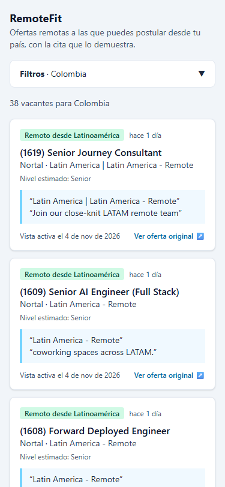
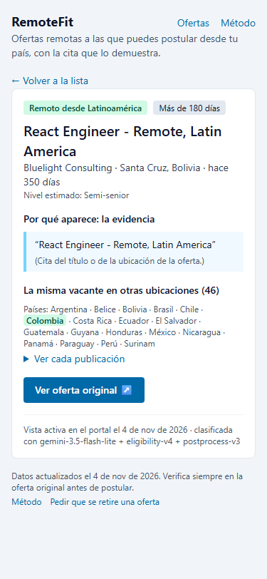
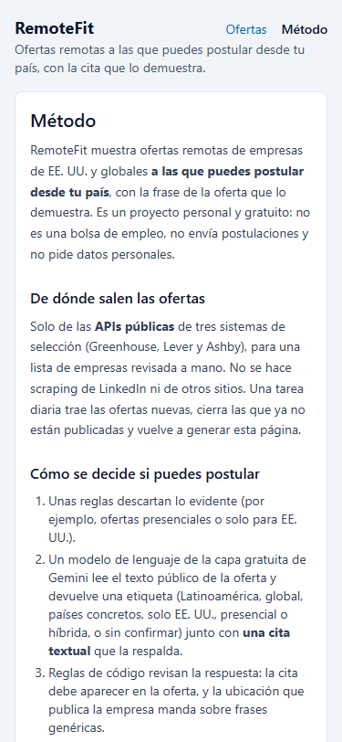
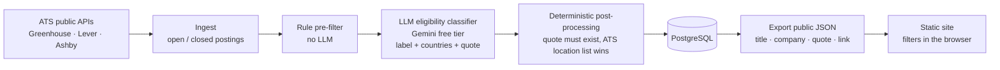

# RemoteFit

**Remote jobs at US and global companies that a Latin American developer can actually apply to — with the sentence from the posting that proves it.**

**Live site:** https://juanmanuelrivera31.github.io/remotefit/ (in Spanish; updated daily)

RemoteFit reads postings from the public job-board APIs of Greenhouse, Lever and Ashby, asks an LLM where each posting really hires, checks the answer with deterministic rules, and shows only the vacancies open to your country. Every card carries a short quote from the posting and a link to the original, so you can verify instead of trusting a label.

  

## The problem

Most "remote" postings are silently restricted: US-only, a single country, "remote" but hybrid, or hiring only through a local entity. Job boards don't tell a developer in Colombia whether *they* can be hired, so they spend hours reading postings they can never apply to. RemoteFit answers that question first, and it is built to prefer saying "not confirmed" over showing a posting you cannot apply to (**precision before recall**).

## How it works



1. **Ingest:** a curated list of companies (`data/companies.json`) is read daily from public ATS endpoints only (no LinkedIn, no scraping of sites that forbid it). Postings that disappear are closed, never deleted. Identical texts share one classification (content hash), and vacancies repeated per country are grouped into one card.
2. **Rule pre-filter:** free rules discard the obvious cases (office-only metadata, non-LATAM locations, non-tech roles).
3. **LLM classifier:** the free tier of the Gemini API (`gemini-3.5-flash-lite`) gets only the public posting text and returns a short JSON validated with Zod: one of six labels (`latam_eligible`, `worldwide`, `country_specific`, `us_only`, `onsite_or_hybrid`, `unclear`), the countries, the work model and **verbatim evidence**. Prompts are versioned (`eligibility-v4`).
4. **Post-processing in code** (`postprocess-v3`): a quote that is not in the posting turns the answer into `unclear`; a country named in the title, or a plain list of places in the ATS location field, overrides generic "work from anywhere" wording.
5. **Applicability per country** is a few lines of plain code (`isApplicable`): remote work model plus a label that covers the user's country.
6. **Publishing:** a daily GitHub Actions job runs the pipeline against a free Neon PostgreSQL and exports a strict JSON (no descriptions, quotes ≤ 160 chars). The React site downloads it once and filters it in the browser with the same pure functions the API uses. USD 0, no credit card anywhere ([ADR 0007](docs/adr/0007-publicacion-costo-cero.md)).

The free tier is treated as a hard budget: a rate-limited queue, one shared request counter per model and Pacific-time day (local evals and the scheduled job count against the same quota), and evaluation runs have priority over classification.

## How it was evaluated

The metric that matters is **precision of "you can apply from Colombia"**, with recall as a floor: the acceptance criterion, fixed before any test run, was **precision ≥ 95 % and recall ≥ 80 %** on a frozen test set, measured on the point value. Each candidate version gets **one** run on a test set nobody has seen. A test set that has been seen is retired to the development split and replaced by fresh postings.

| Test set | Version (prompt + post-processing) | Precision (95 % Wilson CI) | Recall (95 % Wilson CI) | Result |
|---|---|---|---|---|
| test-v1 (112 cases, 61 applicable) | `eligibility-v3` + `postprocess-v1` | 92.2 % (83.0–96.6) | 96.7 % (88.8–99.1) | Not accepted, retired |
| test-v2 (157 cases, 81 applicable) | `eligibility-v4` + `postprocess-v2` | 90.7 % (82.7–95.2) | 96.3 % (89.7–98.7) | Not accepted, retired |
| **test-v3** (144 cases, 92 applicable) | **`eligibility-v4` + `postprocess-v3`** | **97.8 % (92.3–99.4)** | **95.7 % (89.3–98.3)** | **Accepted (2026-11-04)** |

All three runs use `gemini-3.5-flash-lite`. Without the post-processing rules the same model scores 90.7 % precision on test-v3: the gain came from deterministic code built from development-set errors, not from prompt tweaks. That is also why test-v2's failure led to code rules instead of another prompt iteration. Breakdown, error analysis and every false positive and negative: [ADR 0004](docs/adr/0004-taxonomia-y-metrica.md) (Spanish).

**Caveats, stated plainly:**

- **The labels are LLM-assisted.** Claude labelled each case after reading the full posting, following a written guide. Every quote is checked verbatim by code, and the owner reviewed a sample (blind audits: [test-v2](docs/auditoria-test-v2.md), [test-v3](docs/auditoria-test-v3.md)). The numbers measure agreement with those labels, not with a fully human-labelled gold set.
- **Only Colombia is measured.** The site marks the other countries as "sin medir" (not measured).
- The test sets concentrate on a few companies. Without Canonical, Nortal, Sezzle and Lever-hosted boards at once, test-v3 leaves 49 cases with precision 95.2 % (77.3–99.2): the point estimate holds, the interval is wide.
- Users are always told to verify on the original posting, and the site shows the quote that justifies each verdict.

## Privacy and sources

- Only public posting text is sent to the free LLM tier: no profiles, CVs or emails. There is no login, and filters live in the URL.
- Posting text is never versioned or republished in full. The public file holds the title, company, location, a ≤ 160-character quote and the link ([ADR 0002](docs/adr/0002-fuentes-de-ofertas.md), with the review of each ATS's terms). Test fixtures keep the real response shape with synthetic text.
- Anyone can ask for a posting to be removed through a GitHub issue ("Retirar o corregir una oferta").

## Run it locally

Requirements: Node 22+, Docker, and a Gemini API key from Google AI Studio on the **free tier with no billing account linked**.

```bash
cp .env.example .env               # set GEMINI_API_KEY (DATABASE_URL and TEST_DATABASE_URL work as they are)
docker compose up -d               # PostgreSQL 16 on localhost:5433
docker exec remotefit-db-1 psql -U remotefit -d postgres -c "create database remotefit_test"
npm install
npm run db:migrate                 # and once more with DATABASE_URL set to TEST_DATABASE_URL
npm run ingest && npm run prefilter
npm run classify -- --limit 50     # uses the free-tier quota; --dry-run shows the backlog by company
npm run dev                        # API on :3001, web on http://localhost:5173
```

Other commands:

| Command | What it does |
|---|---|
| `npm test` | Every test, including the database ones (they **fail**, not skip, if `TEST_DATABASE_URL` is missing) |
| `npm run lint` · `npm run typecheck` | Static checks |
| `npm run eval -- --split dev` | Evaluation report on the development split (spends quota; cached) |
| `npm run pipeline` | The daily job: ingest → prefilter → classify → export |
| `npm run export` · `npm run build:static` | Public JSON and the static site (`apps/web/dist`) |

Deploying your own copy (Neon, GitHub secrets, Pages, plan B on a PC): [docs/despliegue.md](docs/despliegue.md) (Spanish).

## Stack and layout

TypeScript end to end · Node.js + Express · React 19 + Vite + Tailwind + TanStack Query · PostgreSQL + Drizzle · Zod · Vitest + Testing Library + Playwright · Gemini API free tier behind a provider interface.

- `packages/core`: domain logic with no web framework. ATS connectors, rules, the LLM client and queue, the eligibility classifier and its evaluation (`evals/`), and the shared API contract (`@remotefit/core/api`, browser-safe).
- `apps/api`: Express + Drizzle, plus the CLIs (`ingest`, `prefilter`, `classify`, `export`, `pipeline`).
- `apps/web`: React. It talks to the API locally and reads the static JSON when published.
- `docs/`: vision, architecture, data model, backlog, ADRs and the progress log (Spanish).

Built as a learning project with an AI pair (Claude Code), following written ADRs and a test-first evaluation process.
