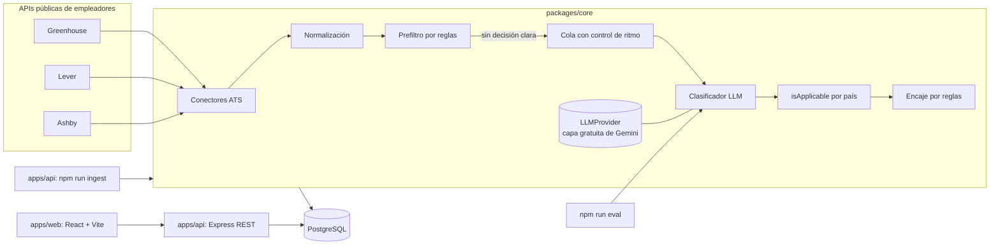

# Arquitectura

## 1. Vista general

Un monorepo en TypeScript con tres piezas. Toda la lógica de negocio vive en `packages/core`, que no sabe nada de HTTP ni de React: así se prueba fácil y se reutiliza desde la API, la línea de comandos y los evaluadores.



## 2. Estructura de carpetas

```text
remotefit/
├── apps/
│   ├── api/                 # Express + TypeScript: API REST y comandos (ingest)
│   │   └── src/
│   │       ├── routes/      # jobs, profile
│   │       ├── db/          # esquema Drizzle, migraciones, conexión
│   │       └── cli/         # ingest.ts, classify.ts
│   └── web/                 # React + Vite + TypeScript + Tailwind
│       └── src/
│           ├── pages/
│           ├── components/
│           └── api/         # cliente tipado + TanStack Query
├── packages/
│   └── core/                # lógica de dominio, sin dependencias de HTTP/UI
│       ├── src/
│       │   ├── ats/         # greenhouse.ts, lever.ts, ashby.ts, types.ts
│       │   ├── normalize/   # NormalizedJob, limpieza de HTML, hash
│       │   ├── rules/       # prefiltro por expresiones regulares
│       │   ├── llm/         # interfaz LLMProvider, proveedor Gemini, pricing.ts
│       │   ├── queue/       # control de ritmo y reintentos, sin I/O propio
│       │   ├── eligibility/ # esquema Zod, prompt versionado, clasificador, isApplicable
│       │   └── fit/         # encaje por reglas deterministas
│       ├── fixtures/        # respuestas reales de cada ATS y ubicaciones reales para pruebas
│       └── evals/           # conjunto etiquetado + runner
├── data/
│   ├── companies.json       # empresas a seguir (ATS + identificador del tablero)
│   ├── llm-limits.json      # RPM, TPM y RPD por modelo (desde S6b)
│   └── seed-career-ops/     # datos reales de la prueba, fuera de git
├── docs/                    # visión, arquitectura, decisiones, backlog, guías
└── .claude/                 # configuración de Claude Code (agentes, skills, hooks, reglas)
```

## 3. Stack y por qué

| Capa | Elección | Razón |
|---|---|---|
| Lenguaje | TypeScript en todo el proyecto | Un solo lenguaje; lo dominas; tipos compartidos entre API y web |
| Monorepo | npm workspaces | Sin herramientas extra; suficiente para tres paquetes |
| Backend | Node.js (LTS) + Express | Lo conoces; el foco del aprendizaje está en la IA, no en un framework nuevo |
| Validación | Zod | Valida entradas HTTP **y** las salidas del LLM con el mismo esquema |
| Base de datos | PostgreSQL + Drizzle ORM | Lo conoces; Drizzle es tipado y genera migraciones; pgvector queda disponible para v0.2 |
| Frontend | React + Vite + Tailwind + TanStack Query | Lo conoces; Vite es rápido; TanStack Query maneja caché y estados de carga |
| Pruebas | Vitest | Rápido, compatible con TypeScript sin configuración extra |
| LLM | Interfaz `LLMProvider`; solo capa gratuita de la API de Gemini, sin facturación vinculada (ADR 0005) | Gasto de USD 0; cambiar de modelo no toca el resto del código |
| Calidad | ESLint + Prettier (hook automático de Claude Code) | Formato consistente sin pensar en ello |

Las decisiones importantes están justificadas en `docs/adr/`.

## 4. Flujo de datos

1. **Ingesta** (`npm run ingest`): por cada empresa de `data/companies.json`, el conector de su ATS descarga las ofertas, las convierte en `NormalizedJob` y calcula `content_hash` (título + ubicación + descripción). Se hace *upsert* por `(source, external_id)`. Se asignan `requisition_id`, cuando el ATS lo expone, y `sibling_group`. Corre a diario y también re-verifica la vigencia, sin LLM (ADR 0002): las ofertas que responden 404 o desaparecen de un board que respondió bien pasan a `is_active = false` con `closed_at`, se ocultan y no se borran. Un error del board no cierra nada, y una oferta que reaparece se reabre.
2. **Prefiltro por reglas**: busca frases con decisión clara. Si encuentra "US only" sin contradicción, guarda `us_only` con `decided_by = 'rules'` y no llama al LLM. Las reglas solo descartan: nunca marcan una oferta como aplicable. Si la ubicación y el cuerpo se contradicen, la oferta pasa al LLM.
3. **Clasificación LLM**: las ofertas activas sin resultado para `(content_hash, prompt_version, model)` entran a la cola. Respuesta en JSON validada con Zod; si falla la validación, un reintento; si vuelve a fallar, `unclear`. Los errores de cuota o de red no generan resultado: la oferta sigue pendiente.
4. **Aplicabilidad**: `isApplicable(result, userCountry)` se calcula en código, sin LLM y sin guardarse (ADR 0004).
5. **Encaje** (`npm run score`): solo para ofertas aplicables y accesibles para el nivel del perfil. Usa reglas deterministas, sin LLM: el perfil nunca sale del sistema.
6. **API y web**: la web pide `/api/jobs?country=CO&seniority=junior&maxAgeDays=180&minScore=60`, muestra la lista y el detalle con la evidencia. Las vacantes hermanas se muestran como una sola, con su lista de países.

## 5. Contrato del clasificador

La taxonomía, los atributos y las reglas de interpretación están en el ADR 0004.

```ts
// packages/core/src/eligibility/schema.ts (borrador)
const CountryCode = z.string().regex(/^[A-Z]{2}$/); // ISO 3166-1 alpha-2

export const EligibilitySchema = z.object({
  label: z.enum([
    "latam_eligible",
    "worldwide",
    "us_only",
    "country_specific",
    "onsite_or_hybrid",
    "unclear",
  ]),
  countries: z.array(CountryCode),
  excludedCountries: z.array(CountryCode),
  workModel: z.enum(["remote", "hybrid", "onsite", "unknown"]),
  workModelConflict: z.boolean(),
  seniority: z.enum(["intern", "junior", "mid", "senior", "lead_or_above", "unknown"]),
  minYearsExperience: z.number().int().min(0).nullable(),
  hiringModel: z.enum(["employee", "contractor", "eor", "unknown"]),
  timezoneRequirement: z.string().max(60).nullable(),
  requiresUsWorkAuthorization: z.boolean().nullable(),
  postingLanguage: z.enum(["en", "es", "pt", "other"]),
  evidence: z.array(z.string().min(1).max(160)).min(1).max(2), // citas textuales de la oferta
});
export type Eligibility = z.infer<typeof EligibilitySchema>;
```

- **Salida corta:** meta de menos de 300 tokens. `maxTokens` se fija algo por encima de la meta, porque un JSON cortado falla la validación y gasta un reintento.
- **Reglas:** cuando decide el prefiltro, el resultado usa el mismo esquema, con la frase encontrada como evidencia y los atributos que no extrae en `unknown` o `null`.

### Proveedores intercambiables

Todo acceso al LLM pasa por esta interfaz. El SDK del proveedor solo se importa dentro de `src/llm/`. En el MVP las implementaciones son `GeminiProvider` y `FakeLLMProvider`, este último para pruebas; agregar otro proveedor no toca el clasificador, pero uno de pago requiere un nuevo ADR.

```ts
// packages/core/src/llm/types.ts (borrador)
export interface LLMUsage {
  inputTokens: number;
  outputTokens: number;
  equivalentCostUsd: number; // price if it were paid; real spend is USD 0
}

export interface LLMProvider {
  readonly name: string; // "gemini", "fake"
  generateStructured<T>(args: {
    model: string;
    system: string;
    user: string;
    schema: z.ZodType<T>;
    schemaName: string;
    maxTokens?: number;
  }): Promise<{ data: T; usage: LLMUsage; model: string }>;
}

export class RateLimitError extends Error {
  constructor(readonly retryAfterMs?: number) {
    super("rate limited");
  }
}

export class QuotaExhaustedError extends Error {}
```

La cola solo conoce estos dos errores: el proveedor traduce sus respuestas 429 a `RateLimitError` (límite por minuto, se reintenta) o `QuotaExhaustedError` (cuota diaria, se pausa).

### Clave de caché

Cada resultado se identifica por **`content_hash` + `prompt_version` + `model`**. Una oferta se clasifica una sola vez y el resultado se comparte entre todos los usuarios y entre ofertas con contenido idéntico. Cambiar el texto, el prompt o el modelo genera una clave nueva y, por tanto, una reclasificación.

## 6. Costos y cuotas

- **Gasto en dinero: USD 0.** Solo se usa la capa gratuita de la API de Gemini, sin cuenta de facturación vinculada (ADR 0005). Pasar a un modelo de pago requiere un nuevo ADR.
- **Frenos de uso:** prefiltro por reglas, caché por clave completa, procesar solo ofertas nuevas o cambiadas, salida corta.
- **Costo equivalente:** cada llamada guarda `tokens_in`, `tokens_out` y `equivalent_cost_usd`, calculado con `llm/pricing.ts`, para saber cuánto costaría pasar a pago.
- **Límites en configuración:** RPM, TPM y RPD varían por modelo y cambian con el tiempo. Se leen en Google AI Studio y se guardan en `data/llm-limits.json`, no en el código.

### Cola con control de ritmo

- Respeta RPM, TPM y RPD. El uso diario se lee de `llm_usage_daily`, para que el conteo sobreviva entre ejecuciones del CLI.
- Ante `RateLimitError` reintenta con espera exponencial y un máximo de intentos. Los reintentos por validación también consumen cuota y se cuentan.
- Orden: ofertas nuevas primero, luego las que cambiaron.
- Ante `QuotaExhaustedError`, o al llegar al RPD configurado, **pausa la clasificación nueva**: el comando termina informando cuántas ofertas quedan pendientes, y la siguiente ejecución las retoma. Lo ya clasificado se sigue sirviendo. En el MVP no hay un proceso permanente; lo pendiente son las ofertas activas sin resultado.
- Avisa en consola al superar el 80 % del RPD. Nunca falla en silencio.

## 7. Seguridad, privacidad y configuración

- Variables en `.env` (nunca en git). Ver `.env.example`.
- La clave del LLM es la de Google AI Studio, se llama `RF_LLM_API_KEY` y se pasa explícitamente al SDK. **No uses `ANTHROPIC_API_KEY` como variable global de Windows**: si existe, Claude Code la usa y te cobra por API en lugar de usar tu plan Pro.
- A la capa gratuita solo se envía **texto público de ofertas**, porque Google puede usarlo para mejorar sus productos. Nunca se envían datos personales de usuarios: perfil, CV o correo. Tampoco las evaluaciones personales de `data/seed-career-ops/reports/`.
- Claude Code tiene prohibido leer `.env` (ver `.claude/settings.json`).
