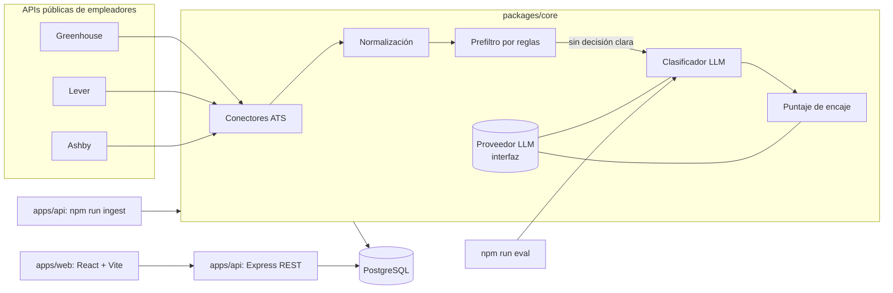

# Arquitectura

## 1. Vista general

Un monorepo en TypeScript con tres piezas. Toda la lógica de negocio vive en `packages/core`, que no sabe nada de HTTP ni de React: así se prueba fácil y se reutiliza desde la API, la línea de comandos y los evaluadores.



## 2. Estructura de carpetas

```text
remotefit/
├── apps/
│   ├── api/                 # Express + TypeScript: API REST y comandos (ingest)
│   │   └── src/
│   │       ├── routes/      # jobs, profile, applications
│   │       ├── db/          # esquema Drizzle, migraciones, conexión
│   │       └── cli/         # ingest.ts, classify.ts
│   └── web/                 # React + Vite + TypeScript + Tailwind
│       └── src/
│           ├── pages/
│           ├── components/
│           └── api/         # cliente tipado + TanStack Query
├── packages/
│   └── core/                # lógica de dominio, sin dependencias de HTTP/UI
│       ├── src/
│       │   ├── ats/         # greenhouse.ts, lever.ts, ashby.ts, types.ts
│       │   ├── normalize/   # NormalizedJob, limpieza de HTML, hash
│       │   ├── rules/       # prefiltro por expresiones regulares
│       │   ├── llm/         # interfaz LLMProvider + implementación Anthropic
│       │   ├── eligibility/ # esquema Zod, prompt versionado, clasificador
│       │   └── fit/         # esquema Zod, prompt, puntaje
│       ├── fixtures/        # respuestas reales de cada ATS guardadas para pruebas
│       └── evals/           # conjunto etiquetado + runner
├── data/
│   └── companies.json       # empresas a seguir (ATS + identificador del tablero)
├── docs/                    # visión, arquitectura, decisiones, backlog, guías
└── .claude/                 # configuración de Claude Code (agentes, skills, hooks, reglas)
```

## 3. Stack y por qué

| Capa | Elección | Razón |
|---|---|---|
| Lenguaje | TypeScript en todo el proyecto | Un solo lenguaje; lo dominas; tipos compartidos entre API y web |
| Monorepo | npm workspaces | Sin herramientas extra; suficiente para tres paquetes |
| Backend | Node.js (LTS) + Express | Lo conoces; el foco del aprendizaje está en la IA, no en un framework nuevo |
| Validación | Zod | Valida entradas HTTP **y** las salidas del LLM con el mismo esquema |
| Base de datos | PostgreSQL + Drizzle ORM | Lo conoces; Drizzle es tipado y genera migraciones; pgvector queda disponible para v0.2 |
| Frontend | React + Vite + Tailwind + TanStack Query | Lo conoces; Vite es rápido; TanStack Query maneja caché y estados de carga |
| Pruebas | Vitest | Rápido, compatible con TypeScript sin configuración extra |
| LLM | Interfaz `LLMProvider`; implementación inicial con la API de Anthropic (modelo pequeño para clasificar) | Permite cambiar de proveedor o usar uno gratuito/local sin tocar el resto |
| Calidad | ESLint + Prettier (hook automático de Claude Code) | Formato consistente sin pensar en ello |

Las decisiones importantes están justificadas en `docs/adr/`.

## 4. Flujo de datos

1. **Ingesta** (`npm run ingest`): por cada empresa de `data/companies.json`, el conector de su ATS descarga las ofertas, las convierte en `NormalizedJob` y calcula `content_hash` (título + ubicación + descripción). Se hace *upsert* por `(source, external_id)`. Las ofertas que ya no aparecen se marcan `is_active = false`.
2. **Prefiltro por reglas**: busca frases con decisión clara. Si encuentra "US only" sin contradicción, guarda `not_eligible` con `decided_by = 'rules'` y no llama al LLM.
3. **Clasificación LLM**: solo para ofertas nuevas o cambiadas cuyo `(content_hash, prompt_version)` no tenga resultado. Respuesta en JSON validada con Zod; si falla la validación, un reintento; si vuelve a fallar, `unclear`.
4. **Encaje**: solo para `eligible` y `likely_eligible`, contra la versión actual del perfil.
5. **API y web**: la web pide `/api/jobs?status=eligible&minScore=60`, muestra la lista y el detalle con la evidencia, y permite cambiar el estado de la aplicación.

## 5. Contrato de la salida del clasificador

```ts
// packages/core/src/eligibility/schema.ts (borrador)
export const EligibilitySchema = z.object({
  status: z.enum(["eligible", "likely_eligible", "unclear", "not_eligible"]),
  allowedRegions: z.array(z.string()),          // "worldwide", "latam", "americas", "us_only", "colombia", ...
  hiringModel: z.enum(["employee", "contractor", "eor", "unknown"]),
  requiresUsWorkAuthorization: z.boolean().nullable(),
  timezoneRequirement: z.string().nullable(),   // p. ej. "EST overlap 4h"
  salary: z.object({
    min: z.number().nullable(),
    max: z.number().nullable(),
    currency: z.string().nullable(),
    period: z.enum(["hour", "month", "year"]).nullable(),
  }).nullable(),
  evidence: z.array(z.string()).min(1),          // citas textuales de la oferta
  reasoning: z.string(),                         // explicación breve
  confidence: z.number().min(0).max(1),
});
```

Reglas de interpretación que el prompt debe aplicar:
- "Remote (US)", "US-based", "must reside in the US", "W-2" → `not_eligible`.
- "Remote — Americas", "LATAM", "worldwide", "anywhere", "contractor" sin restricción de país → `eligible` o `likely_eligible`.
- Sin ninguna señal → `unclear` (nunca inventar).

## 6. Costos del LLM

- La API del LLM **se paga aparte** del plan Pro de Claude. Crea una clave en la consola del proveedor y configura un **límite de gasto mensual** bajo.
- Cada llamada guarda `tokens_in`, `tokens_out` y `cost_usd` para ver el gasto real en el panel y en `npm run eval`.
- Tres frenos de costo: prefiltro por reglas, caché por hash y procesar solo ofertas nuevas.

## 7. Seguridad y configuración

- Variables en `.env` (nunca en git). Ver `.env.example`.
- La clave del LLM se llama `RF_LLM_API_KEY` y se pasa explícitamente al SDK. **No uses `ANTHROPIC_API_KEY` como variable global de Windows**: si existe, Claude Code la usa y te cobra por API en lugar de usar tu plan Pro.
- Claude Code tiene prohibido leer `.env` (ver `.claude/settings.json`).
