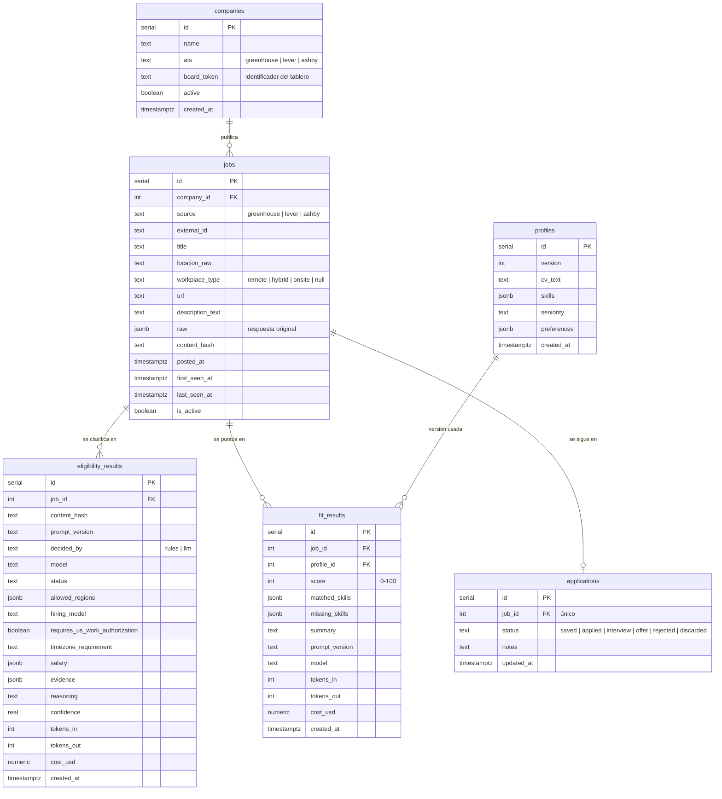

# Modelo de datos (PostgreSQL + Drizzle)

Borrador para la sesión S2. Los nombres de columnas van en `snake_case` en la base y en `camelCase` en TypeScript (Drizzle lo mapea).

## Índices y restricciones

- `jobs`: único `(source, external_id)`; índice en `is_active`, `last_seen_at`.
- `eligibility_results`: único `(job_id, content_hash, prompt_version)` → es la caché.
- `fit_results`: único `(job_id, profile_id, prompt_version)`.
- `applications`: único `job_id`.

## Consulta principal del panel

"Ofertas activas, con el último resultado de elegibilidad `eligible` o `likely_eligible`, con su último puntaje de encaje para el perfil actual, ordenadas por puntaje descendente."
Conviene implementarla como una vista o una consulta Drizzle con `DISTINCT ON (job_id)`.
