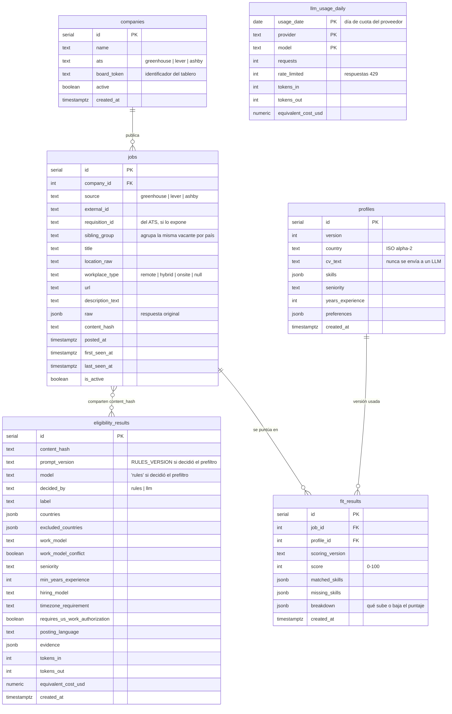

# Modelo de datos (PostgreSQL + Drizzle)

Borrador para la sesión S2. Los nombres de columnas van en `snake_case` en la base y en `camelCase` en TypeScript (Drizzle lo mapea).

## Índices y restricciones

- `jobs`: único `(source, external_id)`; índice en `is_active`, `last_seen_at`, `content_hash`, `sibling_group`.
- `eligibility_results`: único `(content_hash, prompt_version, model)` → es la caché. No lleva `job_id`, para que ofertas con contenido idéntico compartan un solo resultado; la relación con `jobs` es por `content_hash`. `model` nunca es nulo, porque en PostgreSQL los nulos no chocan en un índice único.
- `fit_results`: único `(job_id, profile_id, scoring_version)`.
- `llm_usage_daily`: clave primaria `(usage_date, provider, model)`. Se incrementa en cada llamada, incluidos los reintentos. Va por modelo porque el RPD es por modelo; el costo diario por proveedor se obtiene sumando.

## Notas

- **`sibling_group`:** se calcula en la ingesta con `company_id + requisition_id`, o con `company_id + título normalizado` sin sufijos de región como "(LATAM)" o "(Colombia)" si no hay `requisition_id`. Solo 144 de las 671 ofertas del seed lo traen. El respaldo por título puede unir vacantes distintas con el mismo nombre: verificarlo con datos reales en S4.
- **`llm_usage_daily.usage_date`:** usa el día de cuota del proveedor, no el día local. Según recuerdo, Gemini lo renueva a medianoche hora del Pacífico; confirmarlo en S6b.
- **Cola:** no tiene tabla propia. Lo pendiente son las ofertas activas sin resultado para la clave actual, ordenadas por `first_seen_at` descendente: las nuevas quedan primero.
- **`applications`:** no existe en el MVP. El seguimiento de postulaciones está fuera de alcance (docs/06, sección 4.4).

## Consulta principal del panel

"Ofertas activas con su resultado de elegibilidad vigente y su último puntaje de encaje para el perfil actual, ordenadas por puntaje descendente."

Se implementa en dos pasos. Primero, una consulta Drizzle con `DISTINCT ON (content_hash)` trae las ofertas activas con su resultado, filtrando por nivel y antigüedad. Después, `isApplicable(result, profile.country)` filtra en código, en la API: esa regla es dominio puro y no debe duplicarse en SQL. El volumen del MVP, cientos de ofertas, lo permite.
